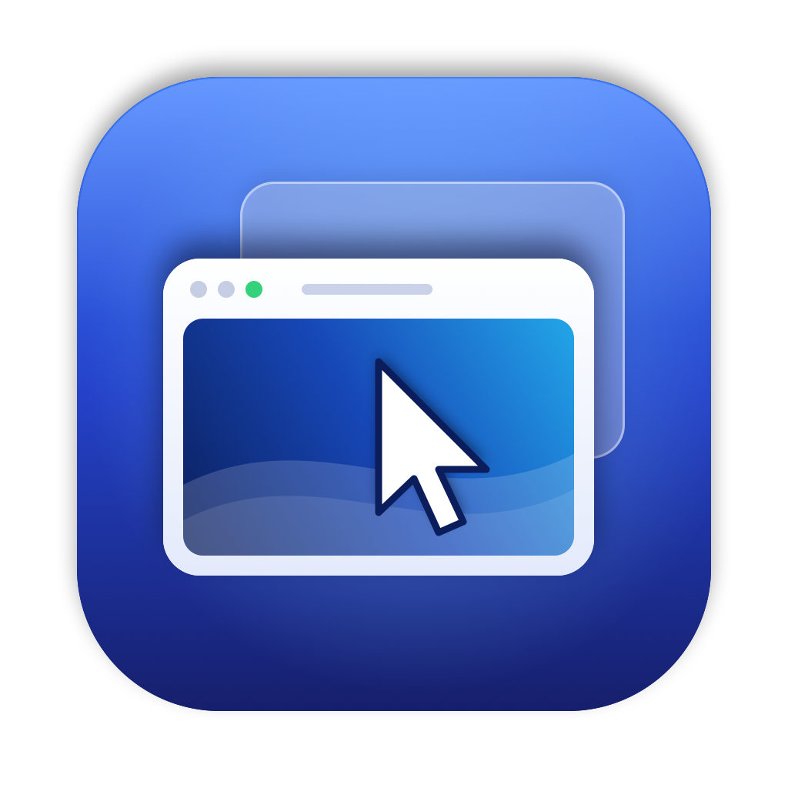
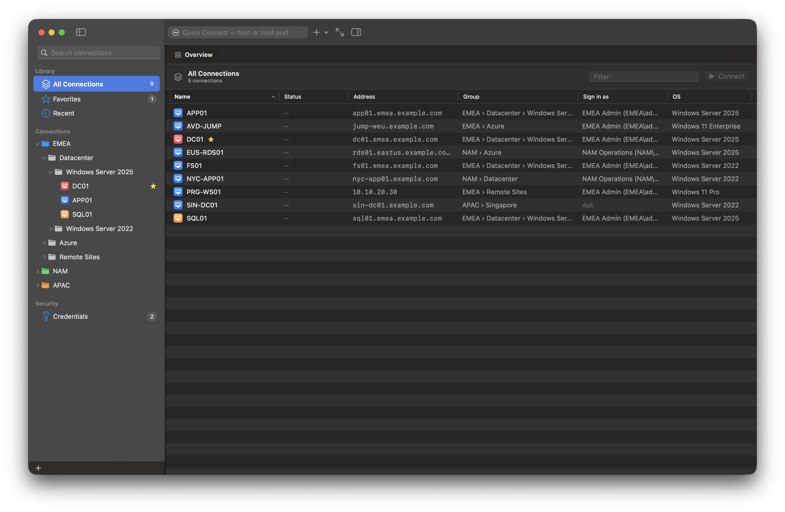
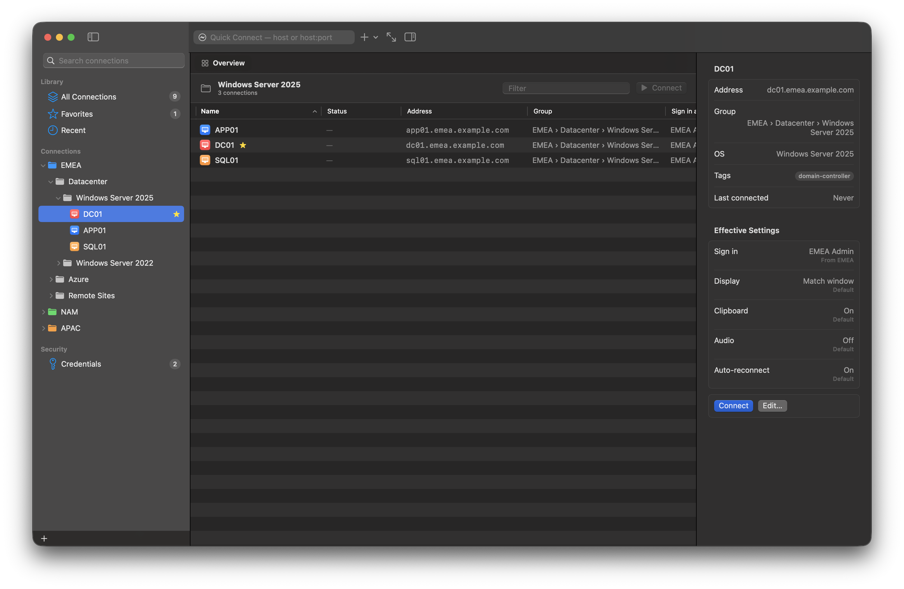
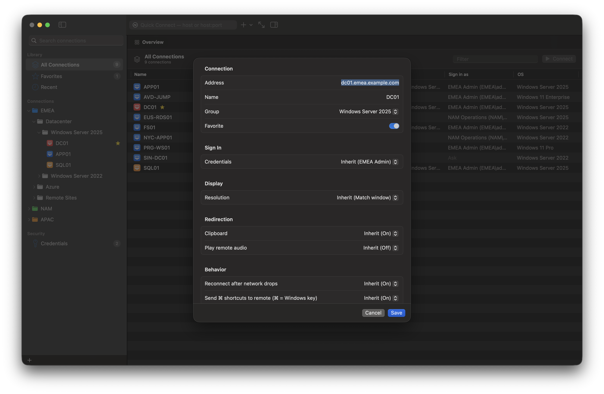
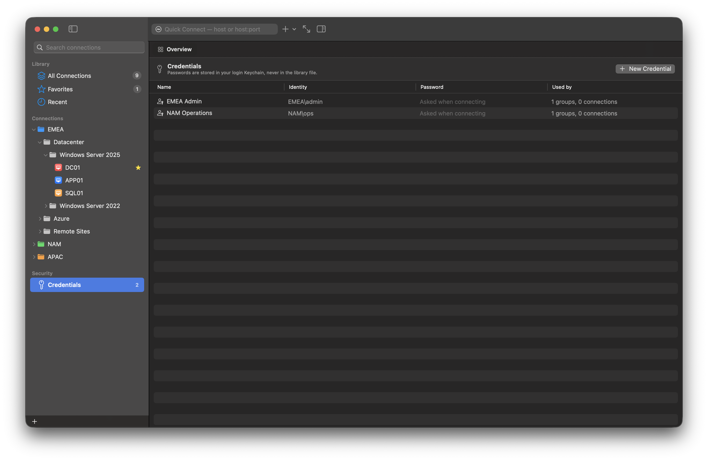
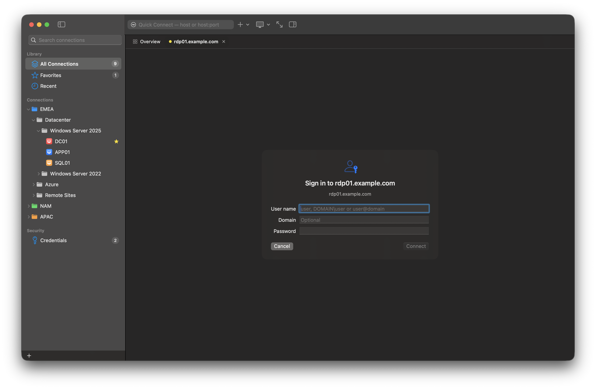

<p align="center"></p>

# RDP Manager

[](https://github.com/patrikcze/rdp-manager/actions/workflows/ci.yml) [](https://github.com/patrikcze/rdp-manager/releases)

A native macOS Remote Desktop manager for administrators who look after many Windows servers. You can organize hosts in nested groups, find any of them instantly, and work in several RDP sessions side by side in tabs or separate windows.

Built with Swift 6, SwiftUI and AppKit on two RDP engines:

- [RDPKit](https://github.com/steelbrain/RDPKit), pure Swift with hardware H.264, for everyday connections.
- [FreeRDP 3](https://github.com/FreeRDP/FreeRDP), bundled, for Kerberos, Standard RDP Security and device redirection.

The app picks the engine per connection.



<table>
  <tr>
    <td></td>
    <td></td>
  </tr>
  <tr>
    <td></td>
    <td></td>
  </tr>
</table>

<sub>Screenshots use the built-in sample library; every host is a placeholder under example.com.</sub>

## Features
- **Connection library:** unlimited nested groups, drag and drop, inline rename, favorites, recent, color labels, tags, notes, and full-text search across names, hosts, tags and group paths.
- **Inheritance:** groups set defaults (credentials, display, clipboard, audio, reconnect, timeout) that hosts inherit or override. The UI shows where each value comes from.
- **Quick Connect (⌘K):** `host`, `host:port` or an IP address. You can save the connection afterwards.
- **Tabbed sessions:** many concurrent sessions, with state shown in the tabs. Tabs can be reordered, moved to their own window, and shown in focus mode or full screen.
- **Remote desktop:** the resolution follows the window at Retina scale, with H.264/AVC444 decoded by VideoToolbox. Your Mac keyboard layout is announced to Windows, ⌘ acts as the Windows key, and Ctrl+Alt+Del and other keys can be sent from a menu. Clipboard text and files work in both directions, and remote audio can play on the Mac.
- **Enterprise:**
  - Kerberos (with NTLM fallback or Kerberos only, plus an optional KDC proxy).
  - Opt-in Standard RDP Security for legacy servers.
  - Printer redirection (every Mac printer).
  - Smart card and YubiKey redirection (PC/SC).
  - Microphone and USB device redirection, and a shared folder.
- **Sign out or disconnect:** Disconnect leaves the Windows session running. Sign Out of Windows… ends it. Ctrl+Option+End sends Ctrl+Alt+Del.
- **Self-contained app:** every library is bundled. `Scripts/make-dmg.sh` builds a distributable DMG, signed and notarized with a Developer ID. Tagged releases publish the DMG on GitHub Releases (RELEASING.md).
- **Security:** passwords stay in the Keychain. Certificates are checked before any credential is sent, and changed certificates are flagged. NLA is the default (Standard RDP Security only when you choose it), and there is no telemetry.
- **Reliability:** bounded automatic reconnect after network drops, never after sign-in or certificate failures. Errors are clear and explain what to do next.
- **Import and export:** Microsoft `.rdp` files in both directions (import reports unsupported settings; Export as .rdp File… writes a connection's effective settings, never its password), plus JSON library export and import without passwords.

## Quick start
```bash
brew install cmake ninja pkgconf openssl@3 krb5 libusb cjson
Scripts/build-freerdp.sh
Scripts/build-app.sh
open "build/RDP Manager.app"
```
Or open `Package.swift` in Xcode and run the `RDPManager` scheme. See [BUILDING.md](BUILDING.md).

## Status
Version 0.3.0. Verified against Windows 11 on both engines: NLA sign-in, rendering, printer redirection and the shared certificate trust. 68 automated tests pass in CI; live sign-in tests passed before the 0.3.0 security fixes and haven't been rerun since. Kerberos, YubiKey/USB and microphone redirection aren't verified live yet, and serial ports are unsupported on macOS. See [TESTING.md](TESTING.md) and [KNOWN-LIMITATIONS.md](KNOWN-LIMITATIONS.md).

## Documentation
[Architecture](ARCHITECTURE.md) · [Design](DESIGN.md) · [Backend decision](RDP-BACKEND-DECISION.md) · [Security](SECURITY.md) · [Testing](TESTING.md) · [Building](BUILDING.md) · [Limitations](KNOWN-LIMITATIONS.md) · [Plan](IMPLEMENTATION-PLAN.md) · [Changelog](CHANGELOG.md) · [Third-party notices](THIRD-PARTY-NOTICES.md)
